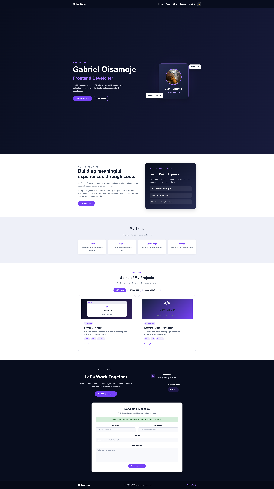
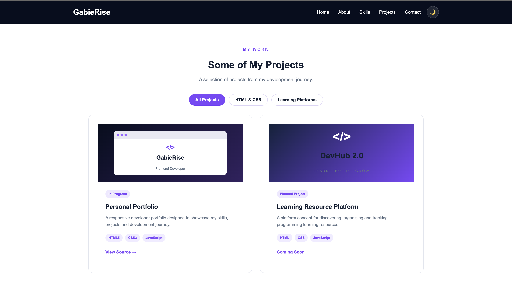

# GabieRise | Personal Developer Portfolio

Welcome to **GabieRise**, my personal developer portfolio website.

This project showcases my journey as a frontend developer, including my technical skills, projects, and experience building responsive and user-friendly web interfaces.

## 🌐 Live Website

**Visit my portfolio:** https://gabierise.github.io/PersonalPortfolio/

## 📌 About the Project

GabieRise is a responsive personal portfolio built to introduce me as a frontend developer and provide visitors with an overview of my development skills and projects.

The website was developed using HTML5, CSS3 and JavaScript, with a focus on clean design, accessibility, responsiveness and interactive functionality.

## ✨ Features

- **Responsive Design:** Adapts to desktop, tablet and mobile screens.
- **Interactive Navigation:** JavaScript-powered mobile navigation menu.
- **Dark and Light Mode:** Allows visitors to switch between website themes.
- **Theme Persistence:** Remembers the visitor's selected theme using Local Storage.
- **Project Filtering:** Filters projects by category.
- **Contact Form:** Includes input validation and Formspree integration.
- **Success and Error Feedback:** Provides feedback during contact form submissions.
- **Smooth Navigation:** Allows visitors to move between website sections.

## 🛠️ Technologies Used

| Technology | Purpose |
|---|---|
| HTML5 | Website structure and semantic markup |
| CSS3 | Styling, layouts and responsive design |
| JavaScript | Interactive functionality and DOM manipulation |
| Local Storage | Saving visitor theme preferences |
| Formspree | Handling contact form submissions |
| Git & GitHub | Version control and project hosting |
| GitHub Pages | Website deployment |

## 📂 Project Structure

```text
developer-portfolio/
│
├── images/
│   └── profile.jpg
│
├── index.html
├── style.css
├── script.js
├── README.md
└── .gitignore
```

## 🚀 Getting Started

You can run this project locally on your computer.

### 1. Clone the repository

```bash
git clone https://github.com/GabieRise/PersonalPortfolio.git
```

### 2. Navigate into the project folder

```bash
cd PersonalPortfolio
```

### 3. Open the project

Open the folder in Visual Studio Code.

### 4. Run the website

Open `index.html` using the Live Server extension in VS Code, or open the file directly in your browser.

No additional package installation or build process is required.

## 📬 Contact

I'm always interested in connecting with other developers, learning new technologies and exploring opportunities to collaborate.

- **Email:** oisamojegabriel@gmail.com
- **GitHub:** https://github.com/GabieRise
- **Portfolio:** https://gabierise.github.io/PersonalPortfolio/

## 🎯 Project Goals

GabieRise is part of my continuous journey towards becoming a skilled frontend developer.

My goals include:

- Improving my HTML, CSS and JavaScript skills.
- Building responsive and accessible websites.
- Developing practical projects.
- Expanding my knowledge of React and TypeScript.
- Becoming more confident in solving real-world frontend development problems.

## 📈 Future Improvements

- Add more projects to the portfolio.
- Improve animations and user interactions.
- Introduce additional accessibility enhancements.
- Expand the portfolio as I learn new technologies.

---

**Built with ❤️ by Gabriel Oisamoje**

*Learn. Build. Improve.*


## 🖥️ Website Preview

Here is a preview of the GabieRise personal portfolio.


## 🖥️ Website Previews

### Desktop View



### Mobile View


### Projects Section



### Dark Mode


## 🚀 Live Website

Visit: https://gabierise.github.io/PersonalPortfolio/
